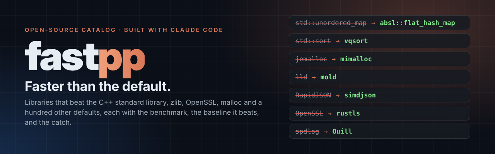
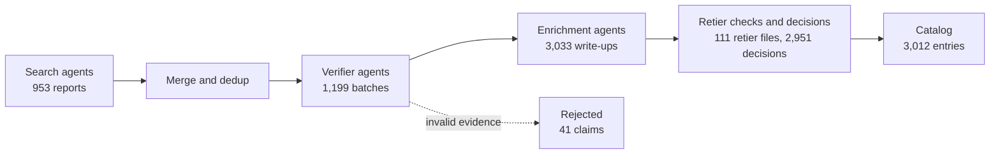

<p align="center">
  
</p>

<!-- fastpp:badges -->
<p align="center">
  
  
  
  
  
  <a href="docs/how-it-was-built.md"></a>
</p>
<!-- /fastpp:badges -->

<p align="center"><b>Find a faster library than the one you are using, along with the benchmark, the baseline it beats, and the catch.</b></p>

**fastpp** is a catalog of open-source libraries and tools that are measurably faster than the defaults developers
reach for: the C++ standard library, zlib, OpenSSL, malloc, nginx, CPython, FFTW, libjpeg-turbo and about a hundred
other incumbents. Every entry names what it beats, quotes the published numbers, grades how far those numbers can be
trusted, and writes down what goes wrong if you adopt it.

<!-- fastpp:stats -->
**3,012 entries** across **101 categories** in **14 domains** · 600 tier A · 483 tier B · 1,669 tier C · 260 tier D · 41 claims rejected
<!-- /fastpp:stats -->

## Find something faster

<!-- fastpp:index -->
| Domain | Entries | Jump to a category |
|---|--:|---|
| [**C++ standard library replacements**](catalog/stdlib-replacements/README.md) | 299 | [Sorting](catalog/stdlib-replacements/sorting/README.md) 28 · [Hash maps and sets](catalog/stdlib-replacements/hash-maps-sets/README.md) 26 · [Math, SIMD and linear algebra](catalog/stdlib-replacements/math-simd-linear-algebra/README.md) 25 · [Number parsing and formatting](catalog/stdlib-replacements/number-parsing-formatting/README.md) 22 · [Perfect hashing and static tables](catalog/stdlib-replacements/perfect-hash-static-tables/README.md) 21 · [Minimal perfect hash functions](catalog/stdlib-replacements/minimal-perfect-hash-functions/README.md) 20 · [Allocators](catalog/stdlib-replacements/allocators/README.md) 17 · [JSON serialization](catalog/stdlib-replacements/serialization-json/README.md) 17 · [+17 more](catalog/stdlib-replacements/README.md) |
| [**Toolchain and build**](catalog/toolchain-and-build/README.md) | 31 | [Compilers and front ends](catalog/toolchain-and-build/compilers-frontends/README.md) 7 · [Formatters, linters and language servers](catalog/toolchain-and-build/formatters-linters-lsps/README.md) 6 · [Build systems](catalog/toolchain-and-build/build-systems/README.md) 5 · [Preprocessors and code generators](catalog/toolchain-and-build/preprocessors-and-codegen/README.md) 5 · [Linkers](catalog/toolchain-and-build/linkers/README.md) 4 · [Compile caching and distribution](catalog/toolchain-and-build/compile-caching-and-distribution/README.md) 4 |
| [**Parsing and text**](catalog/parsing-and-text/README.md) | 102 | [Unicode and UTF-8](catalog/parsing-and-text/unicode-utf8/README.md) 23 · [CSV and tabular data](catalog/parsing-and-text/csv-tabular/README.md) 18 · [Text search and indexing](catalog/parsing-and-text/text-search-and-indexing/README.md) 15 · [Parser generators and combinators](catalog/parsing-and-text/parser-generators-and-combinators/README.md) 12 · [Regex engines](catalog/parsing-and-text/regex-engines/README.md) 12 · [HTML, Markdown and markup](catalog/parsing-and-text/markup-html-markdown/README.md) 11 · [Lexers and tokenizers](catalog/parsing-and-text/lexers-tokenizers/README.md) 11 |
| [**Serialization and formats**](catalog/serialization-and-formats/README.md) | 168 | [JSON](catalog/serialization-and-formats/json/README.md) 69 · [Binary schemas](catalog/serialization-and-formats/binary-schemas/README.md) 53 · [YAML, TOML and XML](catalog/serialization-and-formats/yaml-toml-xml/README.md) 33 · [Reflection and code generation](catalog/serialization-and-formats/reflection-and-codegen/README.md) 13 |
| [**Networking and servers**](catalog/networking-and-servers/README.md) | 181 | [HTTP servers and frameworks](catalog/networking-and-servers/http-servers-frameworks/README.md) 53 · [Event loops and async I/O](catalog/networking-and-servers/event-loops-io/README.md) 44 · [WebSocket, gRPC and RPC](catalog/networking-and-servers/websocket-grpc-rpc/README.md) 25 · [HTTP parsers](catalog/networking-and-servers/http-parsers/README.md) 25 · [DNS, QUIC and HTTP/3](catalog/networking-and-servers/dns-quic-http3/README.md) 18 · [TLS](catalog/networking-and-servers/tls/README.md) 16 |
| [**Storage and data**](catalog/storage-and-data/README.md) | 233 | [Embedded key-value stores](catalog/storage-and-data/embedded-kv/README.md) 52 · [Probabilistic filters](catalog/storage-and-data/probabilistic-filters/README.md) 43 · [Caches](catalog/storage-and-data/caches/README.md) 39 · [Columnar analytics](catalog/storage-and-data/columnar-analytics/README.md) 36 · [Indexes](catalog/storage-and-data/indexes/README.md) 34 · [Message queues and logs](catalog/storage-and-data/message-queues-logs/README.md) 28 · [Database client drivers](catalog/storage-and-data/database-client-drivers/README.md) 1 |
| [**Crypto and hashing**](catalog/crypto-and-hashing/README.md) | 122 | [Non-cryptographic hashes](catalog/crypto-and-hashing/non-crypto-hashes/README.md) 31 · [Encoding (base64, hex, CRC)](catalog/crypto-and-hashing/encoding/README.md) 26 · [Signatures and key exchange](catalog/crypto-and-hashing/signatures-kem/README.md) 23 · [AEAD and ciphers](catalog/crypto-and-hashing/aead-and-ciphers/README.md) 23 · [Cryptographic hashes](catalog/crypto-and-hashing/crypto-hashes/README.md) 19 |
| [**Numerics and science**](catalog/numerics-and-science/README.md) | 453 | [Autodiff and ML kernels](catalog/numerics-and-science/autodiff-and-ml-kernels/README.md) 102 · [Geometry and spatial](catalog/numerics-and-science/geometry-spatial/README.md) 76 · [Random and quasi-random numbers](catalog/numerics-and-science/random-and-quasi-random/README.md) 62 · [BLAS and LAPACK](catalog/numerics-and-science/blas-lapack/README.md) 61 · [Sparse matrices and solvers](catalog/numerics-and-science/sparse-and-solvers/README.md) 60 · [FFT](catalog/numerics-and-science/fft/README.md) 49 · [Big integers and arbitrary precision](catalog/numerics-and-science/big-integer-arbitrary-precision/README.md) 43 |
| [**Compression and encoding**](catalog/compression-and-encoding/README.md) | 153 | [General-purpose lossless compression](catalog/compression-and-encoding/general-lossless/README.md) 72 · [Succinct data structures](catalog/compression-and-encoding/succinct-structures/README.md) 30 · [Entropy coders](catalog/compression-and-encoding/entropy-coders/README.md) 26 · [Integer compression and bit-packing](catalog/compression-and-encoding/integer-bitpacking/README.md) 24 · [Erasure codes](catalog/compression-and-encoding/erasure-codes/README.md) 1 |
| [**Media and graphics**](catalog/media-and-graphics/README.md) | 270 | [Image codecs](catalog/media-and-graphics/image-codecs/README.md) 78 · [Video and audio](catalog/media-and-graphics/video-audio/README.md) 63 · [Color conversion and resampling](catalog/media-and-graphics/color-and-resampling/README.md) 62 · [2D rasterizers](catalog/media-and-graphics/rasterizers-2d/README.md) 40 · [Font shaping and text layout](catalog/media-and-graphics/font-shaping-text-layout/README.md) 26 · [Computer vision](catalog/media-and-graphics/computer-vision/README.md) 1 |
| [**Runtime and systems**](catalog/runtime-and-systems/README.md) | 165 | [Filesystems and I/O](catalog/runtime-and-systems/filesystems-and-io/README.md) 48 · [Allocators and garbage collectors](catalog/runtime-and-systems/allocators-gcs/README.md) 30 · [Thread pools and work stealing](catalog/runtime-and-systems/thread-pools-work-stealing/README.md) 24 · [Logging and tracing](catalog/runtime-and-systems/logging-tracing/README.md) 23 · [Profilers and instrumentation](catalog/runtime-and-systems/profilers-and-instrumentation/README.md) 20 · [Coroutines and fibers](catalog/runtime-and-systems/coroutines-fibers/README.md) 20 |
| [**Interpreters and VMs**](catalog/interpreters-and-vms/README.md) | 229 | [Embedded scripting](catalog/interpreters-and-vms/embedded-scripting/README.md) 62 · [JIT compilers](catalog/interpreters-and-vms/jits/README.md) 61 · [Bytecode VMs and WebAssembly runtimes](catalog/interpreters-and-vms/bytecode-vms-and-wasm/README.md) 56 · [Language interpreters](catalog/interpreters-and-vms/language-interpreters/README.md) 50 |
| [**Assembly, SIMD and WebAssembly**](catalog/assembly-simd-kernels-and-wasm/README.md) | 309 | [WebAssembly libraries and apps](catalog/assembly-simd-kernels-and-wasm/wasm-libraries-and-apps/README.md) 74 · [SIMD intrinsics libraries](catalog/assembly-simd-kernels-and-wasm/simd-intrinsics-libraries/README.md) 65 · [Hand-written assembly kernels](catalog/assembly-simd-kernels-and-wasm/hand-written-asm-kernels/README.md) 48 · [AssemblyScript and WebAssembly languages](catalog/assembly-simd-kernels-and-wasm/assemblyscript-and-wasm-langs/README.md) 48 · [Assemblers and assembly tooling](catalog/assembly-simd-kernels-and-wasm/assemblers-and-asm-tooling/README.md) 34 · [Assembly-level string and memory routines](catalog/assembly-simd-kernels-and-wasm/asm-level-string-and-memory/README.md) 34 · [WebAssembly runtimes and compilers](catalog/assembly-simd-kernels-and-wasm/wasm-runtimes-and-compilers/README.md) 6 |
| [**Other languages beating C, C++ and assembly**](catalog/other-languages-faster-than-c-cpp-asm/README.md) | 297 | [Systems and safety](catalog/other-languages-faster-than-c-cpp-asm/systems-and-safety/README.md) 70 · [Strings and text](catalog/other-languages-faster-than-c-cpp-asm/string-and-text/README.md) 66 · [Web and serving](catalog/other-languages-faster-than-c-cpp-asm/web-and-serving/README.md) 56 · [Runtime JIT beats ahead-of-time](catalog/other-languages-faster-than-c-cpp-asm/runtime-jit-beats-aot/README.md) 46 · [Numerics and arrays](catalog/other-languages-faster-than-c-cpp-asm/numerics-and-arrays/README.md) 38 · [Concurrency runtimes](catalog/other-languages-faster-than-c-cpp-asm/concurrency-runtimes/README.md) 21 |
<!-- /fastpp:index -->

Browse everything from the [catalog index](catalog/README.md), or query the machine-readable export,
[`catalog/catalog.jsonl`](catalog/catalog.jsonl) (one entry per line, [schema](docs/schema.md)).

## Highlights

A hand-picked tier A entry from each domain. Tier A means the benchmark code is public and the compiler, flags and
CPU are on record, so you can rerun it yourself.

<!-- fastpp:featured -->
| Need faster… | Pick | What it is | Tier |
|---|---|---|:-:|
| [Hash maps and sets](catalog/stdlib-replacements/hash-maps-sets/README.md) | [**abseil (absl::flat_hash_map, Swiss tables)**](catalog/stdlib-replacements/hash-maps-sets/abseil-abseil-cpp.md) | SwissTable-based hash map beating std::unordered_map on build, find, churn, and iteration speed. | **A** |
| [Sorting](catalog/stdlib-replacements/sorting/README.md) | [**Highway (vqsort)**](catalog/stdlib-replacements/sorting/google-highway.md) | SIMD-dispatched vectorized quicksort/quickselect for built-in key types; \~10x faster than LLVM std::sort on large arrays. | **A** |
| [Allocators](catalog/stdlib-replacements/allocators/README.md) | [**mimalloc**](catalog/stdlib-replacements/allocators/microsoft-mimalloc.md) | General-purpose malloc drop-in replacement using sharded per-thread free lists; beats jemalloc/tcmalloc on multi-threaded workloads. | **A** |
| [Linkers](catalog/toolchain-and-build/linkers/README.md) | [**mold**](catalog/toolchain-and-build/linkers/rui314-mold.md) | Drop-in ELF linker beating LLVM lld and GNU ld via pervasive data-parallelism across the whole link pipeline. | **A** |
| [Text search and indexing](catalog/parsing-and-text/text-search-and-indexing/README.md) | [**Tantivy**](catalog/parsing-and-text/text-search-and-indexing/quickwit-oss-tantivy.md) | Embeddable Rust full-text search library, architecturally close to Lucene, ahead on phrase/negated/count-heavy queries. | **A** |
| [JSON](catalog/serialization-and-formats/json/README.md) | [**simdjson**](catalog/serialization-and-formats/json/simdjson-simdjson.md) | SIMD-accelerated JSON parser with full UTF-8 validation; \~4x faster than RapidJSON, \~25x than nlohmann. | **A** |
| [TLS](catalog/networking-and-servers/tls/README.md) | [**rustls**](catalog/networking-and-servers/tls/rustls-rustls.md) | Memory-safe Rust TLS 1.2/1.3 library on AWS-LC crypto; beats OpenSSL 3.6.1 per core on handshakes, resumption and AES-GCM bulk. | **A** |
| [Probabilistic filters](catalog/storage-and-data/probabilistic-filters/README.md) | [**Xor Filter (xor_singleheader)**](catalog/storage-and-data/probabilistic-filters/fastfilter-xor-singleheader.md) | Header-only C99 xor and binary fuse filters: static membership filters with fewer bits/key and faster lookups than Bloom/cuckoo. | **A** |
| [Non-cryptographic hashes](catalog/crypto-and-hashing/non-crypto-hashes/README.md) | [**xxHash**](catalog/crypto-and-hashing/non-crypto-hashes/cyan4973-xxhash.md) | SIMD-vectorized non-cryptographic hash family; XXH3 beats CityHash \~2.7x on in-RAM buffer bandwidth. | **A** |
| [Autodiff and ML kernels](catalog/numerics-and-science/autodiff-and-ml-kernels/README.md) | [**FlashAttention-3 (flash-attention)**](catalog/numerics-and-science/autodiff-and-ml-kernels/dao-ailab-flash-attention.md) | Fused exact-attention CUDA kernels (FA2/FA3); FA3 on H100 is 1.5-2x faster than FA2 and beats cuDNN at sequence lengths of 1k and up. | **A** |
| [General-purpose lossless compression](catalog/compression-and-encoding/general-lossless/README.md) | [**Snappy**](catalog/compression-and-encoding/general-lossless/google-snappy.md) | Google's byte-oriented LZ77 codec: about 5x faster compression and 3x faster decompression than zlib -1, with larger output. | **A** |
| [Image codecs](catalog/media-and-graphics/image-codecs/README.md) | [**QOI (Quite OK Image format)**](catalog/media-and-graphics/image-codecs/phoboslab-qoi.md) | Reference C header for the QOI lossless RGB/RGBA format: about 27x faster encode and 3.4x faster decode than libpng, with files about 17% larger. | **A** |
| [Logging and tracing](catalog/runtime-and-systems/logging-tracing/README.md) | [**Quill**](catalog/runtime-and-systems/logging-tracing/odygrd-quill.md) | Asynchronous C++17 logger whose LOG_INFO call site costs single-digit nanoseconds, about 45x below async spdlog at p50. | **A** |
| [Language interpreters](catalog/interpreters-and-vms/language-interpreters/README.md) | [**YJIT (CRuby)**](catalog/interpreters-and-vms/language-interpreters/ruby-ruby.md) | CRuby's built-in Rust JIT; about 2x the CRuby interpreter on Rails-style apps after warmup on x86-64, 1.7x on Graviton4. | **A** |
| [Assemblers and assembly tooling](catalog/assembly-simd-kernels-and-wasm/assemblers-and-asm-tooling/README.md) | [**iced (iced-x86)**](catalog/assembly-simd-kernels-and-wasm/assemblers-and-asm-tooling/icedland-iced.md) | Rust x86/x64 decoder, formatter, encoder and assembler; decodes 4-7x faster than Zydis, XED and bddisasm in disas-bench. | **A** |
| [Systems and safety](catalog/other-languages-faster-than-c-cpp-asm/systems-and-safety/README.md) | [**Rust slice::sort (LangArena Sort::Self) vs C++…**](catalog/other-languages-faster-than-c-cpp-asm/systems-and-safety/lang-rust-kostya-langarena-sort-self.md) | Rust's built-in slice::sort (driftsort) sorts 400k int32 about 2.4x faster than libstdc++ std::sort in LangArena Sort::Self. | **A** |
<!-- /fastpp:featured -->

## What an entry tells you

Every entry has its own page with the same sections:

- **Beats** and **claimed result**: the baseline and the published numbers, with workload, metric, hardware,
  compiler and flags.
- **Evidence tier**: how much the numbers can be trusted (below).
- **Use it when** and **skip it when**: where the win holds and where it does not.
- **How it is fast**: the mechanism (SIMD layout, algorithm, memory behaviour, codegen).
- **Integration**: form, dependencies, minimum toolchain, platforms, thread safety, whether it is a drop-in.
- **Gotchas** and **known shortcomings**: harness flaws, correctness bugs, build traps, licensing problems.
- **Audit trail**: the verifier's verdict and notes, every page it opened, and links to the raw records.

| Tier | Meaning |
|:-:|---|
| **A** | Public benchmark code run against the named baseline, with compiler, flags and CPU model all stated, whoever ran it. Reproducible. |
| **B** | An independent or peer-reviewed measurement that falls short of A. |
| **C** | First-party numbers without the full methodology. |
| **D** | Directional only: no numbers, kept because the project is notable. |

## Honest by design

- **Numbers are published, not re-run.** They come from the projects or from third parties; nothing here has been
  re-measured on our own hardware yet. The tier tells you how far to trust each one.
- **Shortcomings are part of the answer.** An entry whose benchmark is weak, first-party, not faster, or unsafe for
  untrusted input stays in the catalog with the problem written down, instead of being quietly dropped or quietly
  promoted.
- **Invalid evidence is rejected.** A benchmark that timed a `sleep`, another that timed a no-op, a baseline column
  that was hard-coded, an interpreter that pattern-matched the benchmark's function names: those claims are in the
  [rejected list](catalog/rejected.md) with the reason for each.
- **Ratios we computed are labelled.** A ratio a verifier derived from numbers on the cited page says
  "(derived from page data)".

## How it was built

fastpp was researched, verified and written by Claude Code agents over three weeks in September and October 2026,
run as 14 waves (one domain each) plus backfill passes that mined curated lists such as awesome-cpp and awesome-c.

<!-- fastpp:pipeline -->

<!-- /fastpp:pipeline -->

- **Search** agents swept every category across eight source types: GitHub (C++ and any language), papers,
  benchmark shootouts, package registries, blogs and Hacker News.
- **Verifier** agents opened each cited benchmark, checked that it really compares against the named baseline,
  re-derived the evidence tier and rejected invalid evidence.
- **Enrichment** agents read the code and the benchmark harness, then wrote the use, skip, integration and gotcha
  sections. They often found harness defects the verifier missed, and those moved entries down a tier.
- **Retier checks and decisions** record every override, shortcoming and duplicate in
  [`data/decisions.json`](data/decisions.json), so each change can be traced.

Everything is reproducible from the scripts in [`pipeline/`](pipeline/) and the raw records in [`data/`](data/).
The full story, including what went wrong along the way, is in [docs/how-it-was-built.md](docs/how-it-was-built.md).

## For AI agents

Point a coding agent at [AGENTS.md](AGENTS.md) (or [llms.txt](llms.txt)). It explains how to query the catalog and
how to read tiers and shortcomings. A quick start:

```sh
# Tier A hash maps, one JSON object per line
grep '"category": "hash-maps-sets"' catalog/catalog.jsonl | grep '"evidence_tier": "A"'

# Name, tier and one-liner for every JSON parser, best evidence first
jq -r 'select(.category == "json") | [.evidence_tier, .name, .one_liner] | @tsv' catalog/catalog.jsonl | sort
```

## Contributing

Know a faster library, spotted a wrong number, or think a tier should move? See
[CONTRIBUTING.md](CONTRIBUTING.md). Every page under `catalog/` is generated by
[`pipeline/render_lists.py`](pipeline/render_lists.py), so changes go into the records under `data/`.

## License

[MIT](LICENSE) for this repository's text, data and scripts. Each listed project keeps its own license, shown on its
entry; entries marked *study only* have no usable open-source license.
