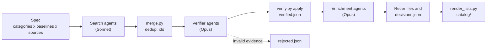

# How fastpp was built

[fastpp](../README.md) › Docs

fastpp started from one question: *when a project reaches for `std::unordered_map`, zlib, OpenSSL or malloc, is
there something measurably faster, and how sure can we be?* Answering it for one library is an afternoon of reading
benchmarks. Answering it for a hundred categories needs thousands of careful reads, so the catalog was built by
Claude Code agents, with one orchestrating session per stage and a written rulebook that every agent followed.

This page tells that story: the pipeline, the rules that kept it honest, what the checks caught, and what went
wrong while running a few thousand agents.

## The pipeline

1. **Spec.** [`pipeline/spec.md`](../pipeline/spec.md) is the rulebook: what counts as "faster than the default",
   the evidence tiers, the output schema, and for every domain a table of categories and the baselines each one
   must beat (for hash maps, `std::unordered_map`; for compression, zlib, zstd, lz4, brotli and xz).
2. **Search.** Each category was searched across eight source types: GitHub with a C++ filter, GitHub in any
   language, papers, benchmark shootouts, package registries, blogs, Hacker News, and a second GitHub pass seeded
   by what the papers found. One Sonnet agent ran per category and source, and each returned JSON records with
   the claim, the benchmark URL, the hardware and the compiler.
3. **Merge.** [`merge.py`](../pipeline/merge.py) folded duplicates across sources and waves, gave every record a
   stable id (usually its canonical repository URL), and kept already-catalogued projects out of later waves.
4. **Verify.** A verifier agent (Opus) received three records at a time. It opened every cited benchmark, checked that
   the page really compares against the named baseline, corrected numbers and metadata, and re-derived the tier.
   Verdicts were confirm, downgrade or reject.
5. **Enrich.** An enrichment agent (Opus in most waves, two entries per agent) read the repository, the benchmark harness and the open
   issues, then wrote the sections developers need: what it does, how it is fast, when to use it and when not to,
   integration notes, gotchas and alternatives. Enrichers kept finding harness defects the verifier had missed.
6. **Retier and decide.** Every finding that changed a record went into a retier file or into
   [`data/decisions.json`](../data/decisions.json) (keep with shortcomings, duplicate, or reject, plus overrides).
   Nothing was edited by hand.
7. **Render.** [`render_lists.py`](../pipeline/render_lists.py) turns the records into the pages under
   [`catalog/`](../catalog/README.md) and the JSONL and CSV exports.

After the 14 domain waves, backfill passes mined curated lists (awesome-cpp, awesome-c and the leads that
enrichers wrote down) for projects the searches had missed, and sent every new seed through the same verify and
enrich stages.

## By the numbers

| | |
|---|--:|
| Domains (one wave each) | 14 |
| Categories | 101 |
| Search reports (category × source, plus seed passes) | 846 |
| Verification batches (three records each) | 1,197 |
| Enrichment write-ups | 3,033 |
| Retier files | 111 |
| Recorded decisions (keep, duplicate, reject, overrides) | 2,947 |
| Duplicates folded into an existing entry | 226 |
| Claims rejected for invalid evidence | 41 |
| Entries in the catalog | 3,012 |
| Commits | 2,200+ |

That is roughly 3,500 agent runs: one per search report, one per verification batch, and one per pair of
enrichments, plus the retier checks.

Timeline: the spec was written on 23 September 2026, wave 1 (the C++ standard library) ran the next day, waves
2 to 7 closed by 26 September, wave 8 (numerics, the largest at about 400 entries) and wave 9 (compression)
closed in early October, waves 10 to 12 (media, runtime, interpreters) ran from cloud sessions by 6 October, the
curated-list backfill closed on 11 October, and waves 13 and 14 (assembly, SIMD and WebAssembly; other languages
beating C and C++) closed on 12 October.

## The rules that kept it honest

**Evidence tiers, re-derived by a second agent.** The search agent proposed a tier; the verifier set it.

| Tier | Requirement |
|:-:|---|
| A | Public benchmark code, run against the named baseline, with compiler, flags and CPU model stated. Anyone can rerun it. |
| B | An independent or peer-reviewed measurement that falls short of A. |
| C | First-party numbers without the full methodology. |
| D | Directional only, no numbers. |

**Keep and document, reject only invalid evidence.** A project that is not actually faster, only first-party,
off-baseline, unsafe for untrusted input or unmaintained stays in the catalog with the problem written into its
entry. Only evidence that is invalid or fabricated is rejected. The precedents that defined "invalid":

- a benchmark that timed a no-op (MQF), and one that benchmarked a `sleep` (FastestJSONInTheWest);
- a baseline column hard-coded in the source (zokio), and a README speedup table that was a hard-coded array
  (zig-evm);
- a fast path that computed a different checksum (stb-zip), a regex fast path that never ran a regex (Pipa), and
  an image-resize path that wrapped `int16` and output zero for bright channels (fast_resize);
- an interpreter that pattern-matched the benchmark's function names and swapped in native loops (R8/NoClip);
- a `bench.sh` that backgrounded the tool with an unquoted `&`, so the timer measured job launch (Imageflow);
- "OpenSSL" columns that actually ran Go code (Go stdlib libp2p), and memory figures copied from design targets
  (r8e).

**Downgrade rules.** Vendor-blog numbers from a company selling the product go to C. Numbers measured on code that
was later fixed for a correctness bug in the hot path go to C. Cross-run comparisons (rows measured on different
days, machines or containers) go to D. Crippled baselines are documented and downgraded: startup inside the timed
region, a Debug build against `-O2`, an assert-enabled build, a garbage collector that never ran while the C
version freed memory.

**Derived ratios are labelled.** When a verifier computed a ratio from numbers on the cited page, the text says
"(derived from page data)".

## What the checks caught

The enrichers read code the verifiers did not, and many entries moved because of it. A few examples from the
records:

- A profiler's "2.25 ns per zone" overhead claim was understated about 12x.
- An allocator benchmark's "jemalloc" row was timing the allocator under test.
- A gRPC benchmark's C++ baseline pre-posted one call per completion queue, a handicap that let six servers built
  in other languages "beat" it; all six moved to tier C.
- A sequence aligner's timer included FASTA parsing for the baseline only.
- A compile-throughput comparison reused a standard-library cache across runs.
- An actor benchmark charged actor-system startup to the baselines only, and a "faster than C" result came from
  a C version that freed every node inside the timed region while the other language never collected.

Each finding is in the entry's *Known shortcomings* and *Audit trail* sections, so a reader sees the number and
the reason not to trust it in the same place.

## Running a few thousand agents: what went wrong

- **A relative path overwrote the README, twice.** An agent saved a fetched `readme.md` with a relative path; on
  macOS's case-insensitive file system that replaced `README.md`. From then on every agent got its own scratch
  directory and absolute output paths, and the orchestrator ran `git status` after every report.
- **Ids drifted during merges.** When a later wave found the same repository under another name or category, the
  merged record could flip identity. A checker script compared merged ids against a snapshot after every merge,
  and overrides pinned the identity of already-verified records.
- **Usage limits killed agents mid-run.** Weekly, session and spend limits each stopped a batch of enrichers at
  least once. Their output files were usually complete, so the rule became: check each orphaned file for the full
  key set before deleting or relaunching anything. Enrichment pairs were pinned so relaunches were idempotent.
- **Concurrency and rate limits.** The Agent tool caps a session at 20 concurrent subagents, GitHub search allows
  about 30 requests a minute across all agents, and the web-search budget is shared by every agent in a session.
  Agents fell back to GraphQL, raw file URLs and repository pages.
- **Restricted network egress in cloud sessions.** Paper hosts, Hacker News and most blogs were unreachable from
  some environments, so those waves' blog and Hacker News passes ran on search snippets, and some papers could
  not be read. Those entries sit at a lower tier than a full read might give them; the open list is in
  [QUEUE.md](QUEUE.md).
- **A date bump restamped history.** Bumping a closed wave's `today` value restamped every verification date in
  it; the rule now is to keep each wave's original date.

The rules and lessons agent sessions follow are in [CLAUDE.md](../CLAUDE.md); the
per-wave history is in [build-log.md](build-log.md).

## Reproduce or extend it

Every step is a script in [`pipeline/`](../pipeline/README.md) and every intermediate record is in
[`data/`](../data/README.md). To add a category or rerun a wave, follow the wave loop in
[CLAUDE.md](../CLAUDE.md#the-wave-loop): render prompts, run the agents, merge, verify, apply, enrich, render.

## What is next

- **Re-run the benchmarks.** The spec's final stage (a code audit that reruns benchmarks on our own hardware) has
  not started; until then every number is a published number.
- **Read the blocked papers.** Paper-access retiers, and re-runs of the blog and Hacker News passes from an
  environment that can reach those sites.
- **Per-language lists and a searchable site.** See the backlog in [QUEUE.md](QUEUE.md).
